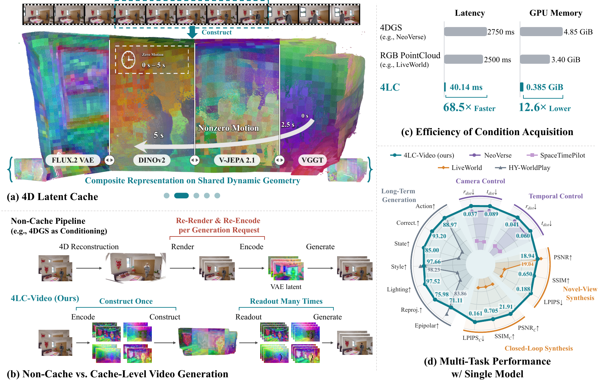

<h2 align="center">4LC: 4D Latent Cache for Efficient Conditioning in Dynamic World Modeling</h2>

<div align="center">

Jianhui Zhang<sup>1,2</sup> &nbsp; Zuyao Lin<sup>3</sup> &nbsp; Pengxin Xu<sup>4</sup> &nbsp; Jingdong Wang<sup>2,✉</sup> &nbsp; Xingyu Chen<sup>2,✉</sup>

<sub><sup>1</sup> SJTU · <sup>2</sup> ZGCA · <sup>3</sup> CASIA · <sup>4</sup> HIT &emsp; ✉&nbsp;Corresponding&nbsp;authors</sub>

<!-- TODO: replace XXXX.XXXXX with the final arXiv identifier throughout this file. -->
<p>
  <a href="https://arxiv.org/abs/XXXX.XXXXX"></a>
  <a href="https://zgca-hmi-lab.github.io/4LC/"></a>
  <a href="https://huggingface.co/jianhuizhang/4LC-Video"></a>
  <a href="https://huggingface.co/spaces/jianhuizhang/4LC-Demo"></a>
  <a href="LICENSE"></a>
</p>

<!-- Main visual: replace this teaser with the project video when available. -->
<p></p>

<p><strong>4LC caches visual representations of static and dynamic content for reuse across times and viewpoints.</strong></p>

[Latent Cache](#latent-cache) · [Installation](#installation) · [Models & Config](#models-and-configuration) · [Inference](#inference) · [Training](#training)

</div>

<!-- News: add a heading and dated announcements when releases are available. -->

## Latent Cache

The standalone `latent-cache` library provides **Construction, Readout and Composition** with caller-supplied encoders, geometry and motion. It requires Python 3.10+ and PyTorch.

```bash
git clone https://github.com/ZGCA-HMI-Lab/4LC.git
cd 4LC
python -m pip install -e ./alc
```

**Encode once, query across views and time.** Given an encoder and prepared observations, configure the Cache and bind each representation to its input stream. See the [complete example](alc/README.md#quick-start) for input preparation.

```python
from latent_cache import LatentCache, LatentCacheConfig

config = LatentCacheConfig(
    image_size=image_size, native_resolution=True,
)
cache = LatentCache(config, {"rgb": (rgb_encoder, "rgb")})
entry = cache.construct(**observations)

# Reuse the observation along another camera path.
views = cache.read(entry, query_times, query_intr, camera_path)

# Keep scene time fixed while the camera moves.
frozen_times = query_times[:, :1].expand_as(query_times)
frozen = cache.read(entry, frozen_times, query_intr, camera_path)

# Add another observation and fill gaps from static history.
cache.construct(**more_observations)
history = cache.compose(query_times, query_intr, camera_path)
background = history.readouts
```

`LatentCacheConfig` controls motion classification and projection. The video application reads the same fields from [cache.yaml](configs/cache.yaml): select it with inference `--cache`, or the training YAML's `cache` reference. See [Cache configuration](alc/README.md#configuration), [input and encoder conventions](alc/README.md#inputs-and-encoders), and [editing](alc/README.md#editing).

## 4LC-Video

### Installation

**Environment and PyTorch** — Linux, Python 3.10, PyTorch 2.6.0 / CUDA 12.4. Video inference and training have been tested on an A100 80 GB.

Run from the repository root:

```bash
conda create -n 4lc python=3.10 -y
conda activate 4lc
python -m pip install torch==2.6.0 torchvision==0.21.0 \
  --index-url https://download.pytorch.org/whl/cu124
```

**Compute extensions**

```bash
python -m pip install torch-scatter \
  -f https://data.pyg.org/whl/torch-2.6.0+cu124.html
python -m pip install gsplat==1.5.3
```

**Core library and application dependencies**

```bash
python -m pip install -e ./alc
python -m pip install -r requirements.txt \
  diffusers==0.37.1 deepspeed==0.16.7
source scripts/env.sh
```

Run `source scripts/env.sh` from the repository root in each new shell to use the bundled DiffSynth, WorldMirror and encoder code.

The [interactive App](app/README.md) supports uploading media, browsing the Cache, previewing conditions and generating videos. It runs locally on a GPU or on Hugging Face ZeroGPU.

### Models and Configuration

Both profiles use **Wan2.1-T2V-14B**. Choose a profile and its matching learned weights:

| Profile | Cached representations | Weights |
| :--- | :--- | :--- |
| [flux-vjepa](configs/models/flux-vjepa.yaml) (default) | RGB / depth / V-JEPA 2.1 | [Download](https://huggingface.co/jianhuizhang/4LC-Video/resolve/main/4lc-video-flux-vjepa.safetensors) |
| [flux-all](configs/models/flux-all.yaml) | RGB / depth / DINOv2 / V-JEPA 2.1 / WorldMirror | [Download](https://huggingface.co/jianhuizhang/4LC-Video/resolve/main/4lc-video-flux-all.safetensors) |

Download the weights to the default location:

```bash
hf download jianhuizhang/4LC-Video \
  --include "4lc-video-*.safetensors" \
  --local-dir local-assets/models
```

`--model` selects the profile; `--weights` overrides the learned-weight path. The supplied video encoders operate at **336 × 560**.

<details>
<summary><b>Download base models and place encoder assets</b></summary>

| Asset | Role |
| :--- | :--- |
| [Wan2.1-T2V-14B](https://huggingface.co/Wan-AI/Wan2.1-T2V-14B/tree/main) | Video backbone, VAE, text encoder and tokenizer |
| [FLUX.2 VAE](https://huggingface.co/black-forest-labs/FLUX.2-dev/tree/main/vae) | RGB and depth features |
| [V-JEPA 2.1 ViT-L/16](https://dl.fbaipublicfiles.com/vjepa2/vjepa2_1_vitl_dist_vitG_384.pt) | Video features |
| [NeoVerse WorldMirror](https://huggingface.co/Yuppie1204/NeoVerse) | Geometry; additional features in `flux-all` |
| [DINOv2-large](https://huggingface.co/facebook/dinov2-large) | Features in `flux-all` only |
| [LightX2V rank-64 LoRA](https://huggingface.co/lightx2v/Wan2.1-T2V-14B-StepDistill-CfgDistill-Lightx2v/tree/main/loras) | Four-step inference and rollout |

Place the files under these paths, or change their locations in the model and encoder YAML files. For FLUX.2, copy the contents of its `vae/` folder.

```text
local-assets/models/
├── Wan2.1-T2V-14B/
│   ├── diffusion_pytorch_model*.safetensors
│   ├── Wan2.1_VAE.pth
│   ├── models_t5_umt5-xxl-enc-bf16.pth
│   └── google/umt5-xxl/
├── FLUX.2-VAE/
│   ├── config.json
│   └── diffusion_pytorch_model.safetensors
├── vjepa2/vjepa2_1_vitl_dist_vitG_384.pt
├── NeoVerse/reconstructor.ckpt
├── dinov2/                       # flux-all only: HF config and weights
└── lightx2v/
    └── Wan21_T2V_14B_lightx2v_cfg_step_distill_lora_rank64.safetensors
```

</details>

**Where to configure each part**

| Configuration | Controls |
| :--- | :--- |
| [cache.yaml](configs/cache.yaml) | Motion classification, projection and readout batching |
| [encoders.yaml](configs/encoders.yaml) | Encoder backends, asset paths and encoding batch sizes |
| [Model profiles](configs/models) | Ordered representation bindings, adapter and control-branch structure |
| [Training profiles](configs/train-flux-vjepa.yaml) | Data, optimizer, updates, checkpoints and shared configuration references |
| [augmentation.yaml](configs/augmentation.yaml) | Training augmentation and unconditional context |

Keep the representation bindings and model structure consistent with the chosen checkpoint. YAML paths are relative to the declaring file; CLI paths are relative to the working directory. Training `--set` overrides apply after model and Cache references are loaded.

### Inference

**Choose a conditioning mode**

| `--mode` | Source | Conditioning | Camera file |
| :--- | :--- | :--- | :--- |
| `control` | Video | Read video features at target times and viewpoints | Optional; defaults to reconstructed source cameras |
| `i2v` | Image | Features condition the first frame only | Required |
| `geometry_i2v` | Image | Reproject first-frame features into target views | Required |

Both image modes use the configured WorldMirror and visual encoders. LightX2V is enabled with four sampling steps; `--no-lightx2v` disables it and `--steps` sets the sampling count.

**Video control**

The default selects 21 keyframes from the first 81 source frames and uses their reconstructed cameras and times. Use `--start-frame` and `--num-frames` to select a clip, or `--camera` to supply a target trajectory in the same world frame.

```bash
python scripts/infer.py --source-type video --mode control \
  --input examples/input.mp4 \
  --prompt "A continuous shot of the scene with natural motion." \
  --output outputs/control.mp4
```

**Image generation**

Choose first-frame-only conditioning or geometric guidance along the same 81-frame camera path:

```bash
python scripts/infer.py --source-type image --mode i2v \
  --input examples/input.png \
  --camera examples/cameras-81.safetensors \
  --prompt "A smooth camera move through the scene." \
  --output outputs/i2v.mp4

python scripts/infer.py --source-type image --mode geometry_i2v \
  --input examples/input.png \
  --camera examples/cameras-81.safetensors \
  --prompt "A smooth camera move through the scene." \
  --output outputs/geometry-i2v.mp4
```

**Rollout with Cache history**

Rollout generates overlapping segments and writes static scene information back to the Cache. History reuse is enabled by default and requires `geometry_i2v`. This two-segment example produces **161 frames**:

```bash
python scripts/rollout.py --mode geometry_i2v \
  --input examples/input.png \
  --camera examples/cameras-161.safetensors \
  --prompt "A smooth camera move through the scene." \
  --output outputs/rollout.mp4
```

- **Segments:** `--chunk-size 81` gives camera lengths of 81, 161, 241, … . For chunk size `C`, `n` segments need `1 + (C-1)*n` camera frames. Cache rollout accepts `4n+1` chunk sizes from 41 to 81.
- **Keyframes:** each segment samples `(C-1)/4+1` keyframes. At 81 frames, 21 are sampled and up to 20 new keyframes are written after dropping the shared first frame. `--num-keyframes` belongs to ordinary video inference.
- **History:** `--order`, `--max-entries` and `--coverage-threshold` control history composition. With `--no-use-cache`, each segment starts from the preceding segment's last frame; both `i2v` and `geometry_i2v` are supported.
- **Input and prompts:** `--source-type video` uses only the video's first frame to initialize rollout. Supply one `--prompt` for the whole trajectory, or repeat it once per segment.

Cache `target_chunk_size` controls **readout batching**; rollout `--chunk-size` controls **generated segment length**.

<details>
<summary><b>Camera file format</b></summary>

Use a safetensors file with floating tensors:

| Field | Shape | Meaning |
| :--- | :--- | :--- |
| `intr` | `[T,3,3]` | Intrinsics normalized by image width and height |
| `c2w` | `[T,4,4]` | OpenCV camera-to-world poses |
| `times` | `[T]` | Scene times in seconds |
| `fps` | Scalar | Output frame rate |

Cameras must share the source scene's world frame. Image generation requires `4n+1` camera frames; rollout follows the segment-length rule above. For video control, camera length must match the generated clip; omitted `times` and `fps` use source timing. Image input and rollout require all four fields. See [coordinate conventions](alc/README.md#inputs-and-encoders).

</details>

**Outputs and reruns**

Each run saves `.mp4`, `.json` (effective configuration and frame count) and `.log` files with the same basename. For rollout, repeat the command with `--resume` to skip matching completed output or restart incomplete output from the first frame. Use a new output path for another ordinary inference run.

### Training

**Prepare data and text context**

Place [SpatialVID-HQ](https://github.com/NJU-3DV/SpatialVID) metadata, videos and captions under `data/SpatialVID/`, or set `data.root` in the training YAML:

```text
data/SpatialVID/
├── data/train/SpatialVID_HQ_metadata.csv
└── SpatialVid/HQ/
    ├── videos/<group>/<id>.mp4
    └── annotations/<group>/<id>/caption.json
```

Captions use `SceneDescription`. Training samples 81 frames at 16 fps and computes geometry and features online. After downloading Wan, generate the empty-prompt context once:

```bash
python scripts/prepare_unconditional_context.py
```

This writes the file below, already referenced by [augmentation.yaml](configs/augmentation.yaml). A custom `--output` must also be set in `condition.prompt_drop.unconditional_context`.

```text
local-assets/augmentation/wan21-unconditional-context.safetensors
```

**Choose a profile and train**

| Profile | Output directory |
| :--- | :--- |
| [train-flux-vjepa.yaml](configs/train-flux-vjepa.yaml) | `outputs/training-flux-vjepa/` |
| [train-flux-all.yaml](configs/train-flux-all.yaml) | `outputs/training-flux-all/` |

One-GPU training with CPU optimizer offload:

```bash
python scripts/train.py --config configs/train-flux-vjepa.yaml \
  --gpus 1 --set training.zero_optimizer_offload=cpu
```

Set `--gpus` for multi-GPU training. Override fields with repeated `--set`, such as `--set optimizer.lr=1.0e-5`. `training.max_updates` is the total target update count, including completed updates.

<details>
<summary><b>Initialize, resume and export</b></summary>

`checkpoint.initial_weights` initializes the learned adapter and control branch. `checkpoint.resume_from` restores model, optimizer, scheduler, RNG and data-reader state:

```bash
python scripts/train.py --config configs/train-flux-vjepa.yaml \
  --gpus 1 --set training.zero_optimizer_offload=cpu \
  --set checkpoint.resume_from=outputs/training-flux-vjepa/latest
```

Export the learned weights for inference:

```bash
python scripts/export_model.py outputs/training-flux-vjepa/latest \
  --output outputs/releases/4lc-video-flux-vjepa.safetensors
```

Pass the exported file to inference with `--weights`, using the same model profile as training.

</details>

## Citation

If you find our library, code, or paper useful in your research, please cite our work:

<!-- TODO: replace XXXX.XXXXX with the final arXiv identifier. -->
```bibtex
@article{zhang2026fourlc,
  title   = {{4LC}: {4D} Latent Cache for Efficient Conditioning
             in Dynamic World Modeling},
  author  = {Zhang, Jianhui and Lin, Zuyao and Xu, Pengxin
             and Wang, Jingdong and Chen, Xingyu},
  journal = {arXiv preprint arXiv:XXXX.XXXXX},
  year    = {2026}
}
```

## Acknowledgements

We thank the authors of [Wan](https://github.com/Wan-Video/Wan2.1), [DiffSynth-Studio](https://github.com/modelscope/DiffSynth-Studio), [NeoVerse](https://github.com/IamCreateAI/NeoVerse), [FLUX.2](https://github.com/black-forest-labs/flux2), [V-JEPA](https://github.com/facebookresearch/vjepa2), [DINOv2](https://github.com/facebookresearch/dinov2), [LightX2V](https://github.com/ModelTC/LightX2V) and [SpatialVID](https://github.com/NJU-3DV/SpatialVID) for their open-source contributions.
